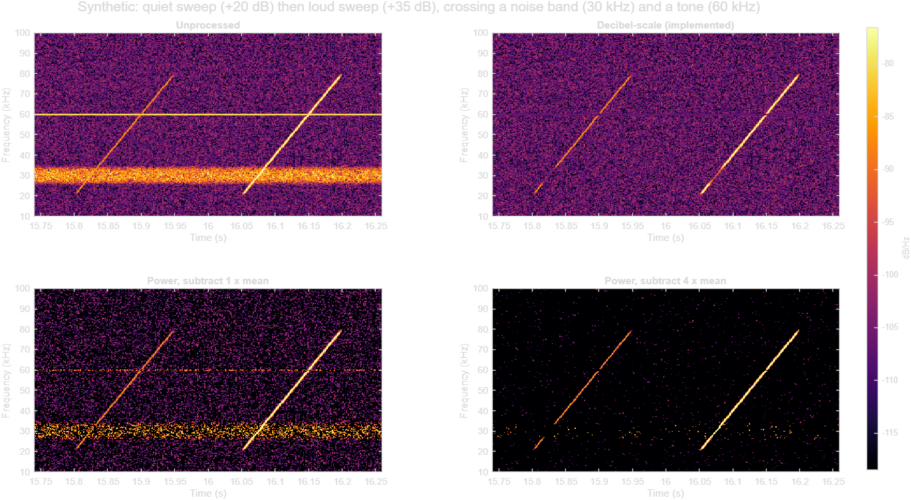

# Background subtraction: procedure and justification

Companion to [BACKGROUND_SUBTRACTION.md](BACKGROUND_SUBTRACTION.md), which covers use. This document states exactly
what is computed, why the subtraction is done on the decibel scale rather than on power, what that choice costs,
and the evidence for it.

The numbers in section 5 come from [analysis/db_vs_power_subtraction.m](analysis/db_vs_power_subtraction.m), which
uses synthetic audio with a fixed random seed and reproduces exactly. The command to run it is in its header.

## 1. Summary

- From the stretches you marked as noise-only, the program measures the typical power at each frequency. That is
  the background, `B(f)`.
- Each frequency row of a spectrogram is then multiplied by a fixed gain, `R / B(f)`, where `R` is the typical
  background level across all frequencies. In decibels this is a subtraction:
  `cleaned = original - B(f) + R`.
- After this, every frequency has the same typical level in background-only audio, so equipment bands no longer
  stand out. Sounds that rise above the background remain.
- The cost: where a call crosses a band, it is dimmed by as much as the band stood above the floor.
- Subtracting power directly was tested and rejected, because it leaves bands as bright speckle and replaces most
  background pixels with an arbitrary value.

## 2. Terms

| Term | Meaning |
|---|---|
| Spectrogram | Grid of values, one per frequency row `f` and time column `t` |
| Power, `P(f,t)` | Power spectral density at that row and column. What MATLAB's `spectrogram` returns as `p` |
| Decibels (dB) | `10 * log10(P)`. Adding decibels is multiplying power: +10 dB is x10, +20 dB is x100 |
| Background, `B(f)` | One number per frequency row: its typical power in noise-only audio |
| Floor | The level of ordinary rows, which hold broadband noise and no band |
| Band | A row, or a few adjacent rows, whose background is well above the floor |

## 3. Procedure

Inputs: a background definition (the audio of your noise-only stretches, and a percentile, 50 by default) and a
spectrogram `P` computed with window length `W` and FFT length `N`.

1. **Frames.** Cut segments of length `W` from the noise audio, starting every `W/2` samples within each marked
   stretch. No segment spans two stretches. If there are more than 2,000, keep 2,000 evenly spaced ones. Fewer
   than 50 is an error. Positions are fixed; nothing is chosen at random.
2. **Power of each frame.** Transform every frame with the same function, window and `N` that produced `P`, so
   the result has the same units and frequency rows as `P`.
3. **Background.** `B(f)` is the chosen percentile across frames in each row. By default, the median.
4. **Reference.** `R` is the median of `B(f)` across all rows: one number.
5. **Gain.** `G(f) = R / B(f)`.
6. **Apply.** `P_clean(f,t) = P(f,t) * G(f)`.

Step 6 in decibels:

```
P_clean [dB]  =  P [dB]  -  B(f) [dB]  +  R [dB]
```

Where a caller uses the complex transform rather than power, it is multiplied by `sqrt(G(f))`, which leaves phase
unchanged and keeps it consistent with `P_clean`.

The alternative that was considered, **power-scale subtraction**, is

```
P_sub  =  max( P - a * B_mean(f),  floor )
```

where `B_mean` is the row's mean noise power, `a` is 1 for plain subtraction or larger for "over-subtraction", and
`floor` is a small positive value that replaces every result at or below zero.

## 4. Why the two methods behave differently

### Noise fluctuates in proportion to its level

The power in a row of random noise is not constant from moment to moment. It follows an exponential distribution,
in which the standard deviation equals the mean. A band 100 times stronger than the floor therefore also fluctuates
100 times more. Put another way, the level of a noise row is a scale factor: divide two noise rows by their
levels and they have the same distribution.

The synthetic recording behaves this way (standard deviation over mean 0.98 in an ordinary row; theory 1), and so
did the lab recordings examined (typical interquartile range 6.9 dB; theory 6.8 dB).

### Effect on a background-only row

| | Decibel-scale: divide by `B(f)` | Power-scale: subtract `B_mean(f)` |
|---|---|---|
| Typical level afterwards | Same in every row | Zero in every row |
| Fluctuation afterwards | Same in every row | Still proportional to the row's original level |
| A band 20 dB above the floor | Indistinguishable from the floor | Its fluctuations are 100 times the floor's, so it remains as a stripe of speckle at about its old height |
| Values at or below zero | None | About 63% of background pixels with `a = 1`, each replaced by the floor value |

Division removes the one thing that distinguishes a noise band from the floor. Subtraction removes the average and
leaves the fluctuations, which are as large as the band was.

Over-subtraction does remove the speckle, by pushing nearly everything below zero: with `a = 4`, 98% of background
pixels become the floor value.

### A steady tone

A constant tone is not random; its row holds a nearly fixed value with small ripples from the noise beneath it.

- Decibel-scale brings the row to the floor's typical level, but it ripples less than its neighbours and so lacks
  their bright pixels. It shows as a faint, smooth, slightly dark line.
- Power-scale with `a = 1` leaves ripples that are still well above the floor, so a speckled line remains.

### Effect on a call

| | Decibel-scale | Power-scale |
|---|---|---|
| What the cleaned value represents | The call's ratio to the local background | The call's own power |
| Call crossing an ordinary row | Unchanged, apart from the flattening of the floor | Unchanged |
| Call crossing a band | Reduced by the band's height above the floor | Kept, with the band's fluctuations added |
| Call weaker than the band, at the band | Not visible there | Not visible there |

Neither method recovers a call that is weaker than the band where they cross. That part of the call is under the
noise in the recording itself.

### Effect on what DeepSqueak does next

| Step | Why the scale matters |
|---|---|
| Training, detector and clustering images | All take `log10` of power first. Decibel-scale subtraction is a shift of rows in the space the images are made in, with no clipping. Power subtraction yields zeros and negatives that cannot be logged, so the floor value sets the black level and, through min-max rescaling, the contrast of the whole image |
| Contour (loudest frequency at each time) | Speckle left in a band by power subtraction still beats quiet calls |
| Tonality (evenness of magnitude across frequency) | Depends on the whole distribution across rows; pixels filled with a floor value distort it |
| Reversibility | Each row was multiplied by a known positive number, so the original is recovered exactly by dividing. Clipped pixels cannot be recovered |
| Consistency | The gain depends only on the definition and the spectrogram's resolution, never on the audio being cleaned |

## 5. Evidence

Synthetic recording: a white-noise floor; a steady tone at 60 kHz, 28.6 dB above the floor; a band of random noise
around 30 kHz, 20.0 dB above the floor; 40 quiet sweeps (+20 dB) and 40 loud sweeps (+35 dB) from 20 to 80 kHz that
cross both. The background was taken from 3 s without sweeps, and the background-only measures from a separate 3 s.



| Measure | Unprocessed | Decibel-scale | Power, 1 x mean | Power, 4 x mean |
|---|---|---|---|---|
| Background only: bright pixels of the noise band, relative to ordinary rows | +20.0 dB | -0.1 dB | +19.9 dB | all at floor value |
| Background only: bright pixels of the tone row, relative to ordinary rows | +22.7 dB | -5.9 dB | +14.2 dB | all at floor value |
| Background pixels replaced by the floor value | 0% | 0% | 63.1% | 98.2% |
| Quiet sweeps: loudest frequency falls on the sweep | 0% | 98.4% | 16.1% | 90.1% |
| Loud sweeps: same | 100% | 100% | 100% | 100% |
| Tonality's evenness measure, background only (0.845 expected for plain noise) | 0.59 | 0.85 | 0.38 | 0.89 |

"Bright pixels" is the 95th percentile of a row. "Falls on the sweep" means within two rows of the true position,
scored away from the band and tone, over roughly 2,600 time columns per sweep level. The floor value was set 20 dB
below the typical background.

What the table shows:

- **Band removal.** Decibel-scale brings the noise band to within 0.1 dB of ordinary rows. Plain power subtraction
  leaves it where it was.
- **Quiet calls.** Unprocessed, the tone always beat the quiet sweeps. Decibel-scale found the sweep 98.4% of the
  time; plain power subtraction 16.1%, because leftover speckle kept winning; over-subtraction 90.1%.
- **Loud calls** were found by every version, being louder than both bands.
- **Tonality.** Decibel-scale gives the value expected for plain noise. Plain power subtraction gives a much lower
  one, which DeepSqueak would read as tonal. Over-subtraction's value describes a column that is 98% floor value.
- **In the figure, not the table.** In the decibel-scale panel the loud sweep dims where it crosses 60 kHz and
  through the 30 kHz band. In the power panels it stays bright there. This is the cost described next.

This evidence is synthetic: one tone, one band, straight sweeps. It shows the mechanisms. It does not measure
performance on lab recordings.

## 6. What it costs

**A call is dimmed where it crosses a band, by exactly as much as the band stood above the floor.** A call 35 dB
above the floor crossing a tone 28.6 dB above the floor comes out about 6 dB above the floor at that point. It is
continuous but dim there, and in an image it can look like a gap. Power subtraction would have kept that point at
full level; this is its one advantage.

Consequences when using the results:

- **Composite shapes of calls will carry a dip at band frequencies**, as deep as the band was high, wherever the
  contributing calls crossed a band. The dip is missing information, not a property of the calls. The gain at each
  frequency can be recomputed from the definition, so the affected frequencies and the depth can be reported with
  any composite.
- **Cleaned values are relative to background.** `Mean Power (dB/Hz)` for a recording with a background is level
  above local background plus a constant, not absolute level. For absolute power, measure without a background.
- **The broad slope of the floor is flattened along with the bands.** In the lab recordings sampled, the floor
  fell about 13 dB from 10 to 80 kHz, so after cleaning a low-frequency call is dimmer relative to a
  high-frequency one than before.
- **It equalizes; it does not uncover.** No pixel's ratio of call to noise improves. What changes is that bands
  stop dominating images, maxima and across-frequency statistics.
- **Steady tones become faint smooth lines**, not perfectly invisible ones.

## 7. Choices within the method

| Choice | Reason | Consequence |
|---|---|---|
| Median across frames for `B(f)` | Barely moved by brief sounds that slipped into a marked stretch. For random noise it is a fixed fraction of the mean in every row, which cancels against `R` | For a source that pulses, the median describes the quiet moments, so pulses remain. A definition can use a higher percentile |
| `R` is the median of `B` across frequencies | Keeps the overall level, so display limits and thresholds stay roughly where they were | `R` is one number for all rows. Changing it shifts every value equally and cannot change how one row looks beside another |
| The whole background shape is removed, not only narrow bands | It is what was measured from the noise-only stretches | Values become relative to local background (section 6) |
| Background re-measured at each spectrogram's own resolution | A tone's height above the floor depends on the window length, so one measurement does not fit all resolutions | The definition stores audio, not a spectrum |

## 8. Residual stripes, and two things that were tried

After cleaning, faint dark or light lines can remain at band frequencies. This section records where they come
from and what was tried against them on 2026-10-08. All measurements are from one lab recording
(384 kHz), using its ten marked noise stretches (29.3 s in total): a definition is built
from nine stretches and the tenth is measured, for each of the ten in turn. That gives 273 measurements of band
rows and 3,247 of floor rows. A band row here is one whose background is more than 3 dB above the local floor.

### Where the stripes come from

Floor rows come out uniform: their typical level varies by 0.27 dB (RMS) from row to row. Band rows do not: their
typical level is off by 1.85 dB RMS, and by as much as 7.1 dB, in either direction. Two causes:

1. **Bands change strength over time.** Where a band is weaker than it was in the marked stretches it is
   over-corrected and looks dark; where stronger, it is under-corrected and looks light. A definition is one
   fixed background, so it is right only on average.
2. **Steady bands flicker less than noise.** A row brought to the right typical level, but with less
   moment-to-moment variation than its neighbours, has dimmer bright pixels and reads as a dark line. In this
   recording the effect is small: band rows needed exponents between 0.83 and 1.94 to match the floor's flicker,
   with a median of 1.02.

### Tried: taking the reference from floor rows only

Suggested because a recording with many bands pulls the all-rows median upward. It was built, tested and then
reverted. `R` multiplies every row by the same number, so it cannot make one row lighter or
darker than its neighbours; on this recording the two rules differed by the same 0.07 dB in every row. Definitions
made while that rule was in use (format 2) still load and still give the results they gave then.

### Tried: flicker scaling

Built as an option, **off by default**, chosen when a definition is made. It addresses the second cause. Each
row's deviation from its own background is multiplied by an exponent `k(f)`:

```
P_clean [dB]  =  R [dB]  +  k(f) * ( P [dB]  -  B(f) [dB] )
```

`k(f)` is the typical row's flicker divided by this row's flicker, where flicker is the interquartile range, in
dB, of the row's power in the noise stretches (about 6.8 dB for random noise). A steady tone gets `k` above 1, a
pulsing source below 1, random noise close to 1. `k` is limited to between 0.5 and 2; without a limit, a very
steady tone would have any small mismatch with the definition magnified without bound. With `k = 1` everywhere
this is exactly the procedure in section 3.

Measured on the recording above, as the deviation of band rows from floor rows after cleaning (dB):

| Method | Typical level, RMS | Typical level, worst | Bright pixels, RMS | Bright pixels, worst |
|---|---|---|---|---|
| Level only (default) | 1.85 | 7.1 | 1.94 | 9.4 |
| Flicker scaling as built | 2.09 | 13.7 | 1.87 | 12.3 |
| Flicker scaling on linear power (tried in the analysis only, not built) | 2.57 | 20.0 | 2.35 | 26.4 |

"Bright pixels" is the 95th percentile of a row. Floor rows were unaffected by all three (0.25 to 0.29 dB).

Flicker scaling made the bright pixels of band rows slightly more uniform on average (16% of measurements improved
by more than 0.5 dB, 5% worsened) and made typical levels slightly less uniform (none improved, 5% worsened). Its
worst cases were markedly worse. The reason is the first cause: when a band's strength has drifted from the
definition, an exponent above 1 magnifies the drift. In this recording drift is the larger effect, so flicker
scaling does not pay for itself. The linear-power form, which an earlier draft of this document proposed, magnifies
drift more and was worse on every measure.

**Recommendation from this evidence: leave flicker scaling off.** It may suit a recording whose bands are steady
tones of constant strength; none has been examined. The evidence is one recording and 29 s of noise.

What does help with the first cause: marking noise stretches spread across the whole session, so the definition
reflects each band's usual strength. Removing it would need a background that follows the recording over time,
which is out of scope by design.

### Other consequences of flicker scaling, if it is used

- A call's level in a row with `k` not equal to 1 is no longer its ratio to background; it is that ratio raised
  to the power `k`.
- What is applied at each point depends on the value at that point, not only on its row. It is still fully
  determined by the definition, and still reversible.
